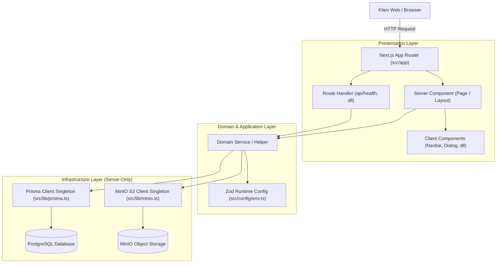

# Arsitektur Aplikasi: TampilKit Booking

Dokumen ini menjelaskan struktur arsitektur, batasan modul (*module boundaries*), model data, dan alur data (*data flow*) untuk proyek **TampilKit Booking**.

---

## 1. Prinsip Arsitektur: Modular Monolith

TampilKit Booking dirancang menggunakan pendekatan **Modular Monolith** berbasis **Next.js App Router**:
- **Bukan Microservices**: Seluruh domain berada dalam satu basis kode tanpa overhead jaringan antar service independen.
- **Bukan Monolith Acak**: Domain diorganisasikan per modul fungsional di `src/modules/` dengan kontrak interface yang jelas.
- **Server-First Boundary**: Pemisahan tegas antara Server Components/Route Handlers dan Client Components interaktif.
- **Database Encapsulation**: Komponen UI tidak melakukan query basis data secara langsung; seluruh akses data dilakukan via Server Components atau Route Handlers yang memanggil Service/Repository.

---

## 2. Struktur Modul & Batasan Domain (`src/modules/`)

Setiap modul di `src/modules/` dipersiapkan untuk mengelola logika bisnis secara mandiri:

1. **`auth/`** *(Fase 02 — Selesai)*:
   - Logic hashing Argon2id, issue/refresh JWT access token (15m) & refresh token (7d).
   - Session Lineage tracking (`AuthSession`, `RefreshTokenRecord`) & deteksi token reuse (family revocation).
   - Guard otorisasi peran (`OWNER`, `ADMIN`), CSRF validation, rate limiting, dan pencatatan audit (`AuthAuditLog`).
2. **`business/`** *(Fase 03 — Selesai)*:
   - Pengaturan profil bisnis (`Business`), jam operasional 7 hari & multi-break (`BusinessOperatingHour`, `BusinessOperatingBreak`), dan parameter reservasi (`BusinessSetting`).
3. **`services/` & `categories/`** *(Fase 03 — Selesai)*:
   - Pengelolaan kategori (`ServiceCategory`) dan menu layanan grooming (`Service`) dengan harga presisi `Decimal` IDR dan upload foto MinIO.
4. **`gallery/` & `storage/`** *(Fase 03 — Selesai)*:
   - Pengelolaan galeri foto toko (`BusinessGallery`) dan layanan media MinIO S3 terisolasi server-side dengan validasi magic bytes.
5. **`public/`** *(Fase 04 — Selesai)*:
   - Lapisan data publik terisolasi (`public-business`, `public-services`, `public-gallery`, `public-hours`), technical SEO (JSON-LD, dynamic metadata), dan sitemap/robots.
6. **`availability/`** *(Fase 05 & 06 — Selesai)*:
   - Mesin kalkulasi slot waktu, interval jadwal half-open `[startAt, occupancyEndAt)`, kalkulasi buffer dinamis, dukungan `ResourceBlock`, dan `excludeBookingId` untuk alur reschedule.
7. **`customers/`** *(Fase 05 & 06 — Selesai)*:
   - Pengelolaan data profil pelanggan (`Customer`), daftar hewan peliharaan (`Pet`), serta kalkulasi riwayat kunjungan & total nilai belanja riil.
8. **`bookings/`** *(Fase 05 & 06 — Selesai)*:
   - Siklus hidup transaksi reservasi (`Booking`), pembuatan `bookingCode` (`GRM-YYYYMMDD-XXXX`), state machine status (`PENDING -> CONFIRMED -> CHECKED_IN -> IN_PROGRESS -> COMPLETED`, terminal: `COMPLETED`, `CANCELLED`, `NO_SHOW`), mitigasi race-condition via PostgreSQL Advisory Lock, penjadwalan ulang (*reschedule*), pembatalan, pembuatan walk-in booking, manajemen blokir waktu (`ResourceBlock`), dan jejak audit komprehensif (`BookingAuditLog`).
9. **`storage/`** *(Fase 01 & Berkelanjutan)*:
   - Abstraksi upload, validasi tipe MIME/ukuran berkas, dan penghapusan objek S3 terenkapsulasi di `src/lib/minio.ts`.
10. **`calendar/` & `integrations/google/`** *(Fase 07 — Selesai)*:
    - Integrasi Google Calendar API v3, otorisasi OAuth 2.0 PKCE, enkripsi token AES-256-GCM, antrean transaksi outbox `CalendarSyncJob` dengan worker proses mandiri, integrasi Google FreeBusy ke Availability Engine, webhook push notifications, dan rekonsiliasi konflik jadwal.
11. **`qa/`, `observability/` & `runbooks/`** *(Fase 08 — Selesai)*:
    - Pengujian konkurensi PostgreSQL (10 skenario), liveness & readiness health probe semantics (`/api/health`), simulasi backup/restore drill, hardening OWASP ASVS 5.0, audit aksesibilitas WCAG 2.1 AA, dan paket runbook produksi.

---

## 3. Alur Data & Request Lifecycle

---

## 4. Model Data Prisma (Entitas Relasional)

Skema basis data mencakup 17 model relasional:
1. **User**: Akun administratif dengan peran `OWNER` atau `ADMIN`, kata sandi ter-hash Argon2id.
2. **BusinessProfile**: Informasi legal usaha, timezone (default `Asia/Jakarta`), slug, alamat toko.
3. **BusinessOperatingHour & BusinessOperatingBreak**: Jadwal jam operasional mingguan (7 hari) dan rentang jam istirahat.
4. **BusinessSetting**: Parameter reservasi, interval booking (menit), buffer time, min advance time, max booking window.
5. **BusinessGallery**: Foto galeri toko tersimpan di MinIO S3 dengan display order.
6. **ServiceCategory**: Pengelompokan jenis layanan grooming (aktif/nonaktif, display order).
7. **Service**: Rincian layanan grooming, durasi (menit), buffer time, dan harga presisi `Decimal` IDR.
8. **Customer**: Profil kontak pelanggan (nama, nomor telepon/WhatsApp, email opsional).
9. **Pet**: Profil hewan peliharaan berelasi ke pelanggan (nama, jenis `DOG`/`CAT`/`OTHER`, ras, usia, catatan medis/kebiasaan).
10. **BookingResource**: Stasiun kerja fisik grooming (contoh: "Main Grooming Station") sebagai unit kapasitas terbagi.
11. **Booking**: Entitas transaksi reservasi dengan snapshot harga/durasi/layanan, interval waktu half-open (`startAt`, `serviceEndAt`, `occupancyEndAt`), status (`PENDING`, `CONFIRMED`, `CHECKED_IN`, `IN_PROGRESS`, `COMPLETED`, `CANCELLED`, `NO_SHOW`), source (`PUBLIC_GUEST`, `WALK_IN`, `ADMIN`), dan catatan internal.
12. **BookingStatusHistory**: Riwayat kronologis setiap perubahan status reservasi lengkap dengan aktor staf pelaksana dan alasan.
13. **BookingRescheduleHistory**: Riwayat perubahan jadwal reservasi (`previousStartAt`, `newStartAt`, aktor, alasan).
14. **BookingAuditLog**: Log audit peristiwa penting pada siklus pemesanan.
15. **ResourceBlock**: Pemblokiran interval waktu stasiun grooming manual oleh admin untuk pembersihan, servis alat, atau meeting.
16. **BookingAccessToken & BookingIdempotency**: Keamanan reservasi publik (token akses tamu tersanitasi & kunci idempotensi).
17. **CalendarConnection & CalendarEventMapping**: Pemetaan integrasi kalender eksternal (disiapkan untuk Fase 07).

---

## 5. Keamanan & Sanitasi Lingkungan

- **Secrets Isolation**: Kredensial basis data dan storage tidak pernah dicantumkan pada kode sumber atau repositori publik.
- **Client Shield**: Modul storage `minio.ts` ditandai dengan `import "server-only"` untuk mencegah kebocoran runtime ke bundel client browser.
- **Runtime Validation**: Seluruh variabel lingkungan divalidasi saat startup melalui Zod (`src/config/env.ts`).
- **Error Sanitization**: Pesan error pada route handler dan health check difilter untuk tidak menampilkan credential connection string atau stack trace sensitif ke publik.
