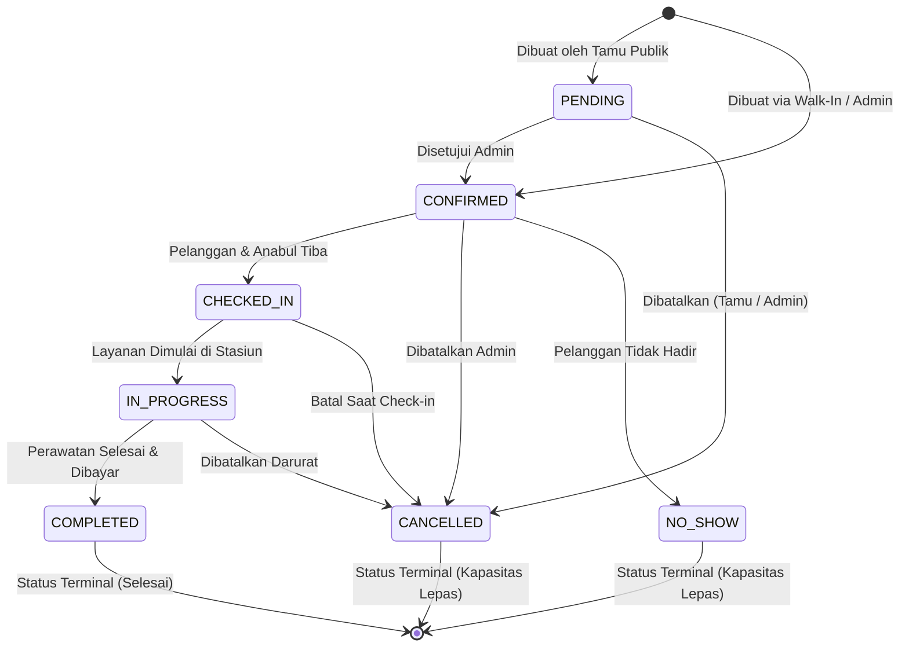

# Booking Status Workflow & State Machine

Dokumentasi diagram status, aturan transisi, validasi bisnis, dan pencatatan audit log untuk siklus hidup pemesanan (*Booking Lifecycle*) pada **TampilKit Booking (PawCare Grooming)**.

---

## 1. Diagram State Machine

---

## 2. Definisi Status & Perilaku Bisnis

| Status | Tipe | Deskripsi & Dampak Kapasitas |
| :--- | :--- | :--- |
| `PENDING` | Aktif | Menunggu verifikasi staf. Slot waktu tetap dikunci agar tidak ditimpa pemesanan lain. |
| `CONFIRMED` | Aktif | Jadwal telah dikonfirmasi dan siap dilayani. Kapasitas slot terkunci. |
| `CHECKED_IN` | Operasional | Pelanggan dan hewan peliharaan sudah tiba di salon PawCare. |
| `IN_PROGRESS` | Operasional | Hewan sedang dalam proses pemandian/grooming di meja stasiun grooming. |
| `COMPLETED` | Terminal | Sesi perawatan selesai, pembayaran lunas di tempat. Rekam transaksi final. |
| `CANCELLED` | Terminal | Pemesanan dibatalkan. Waktu slot **dilepaskan** kembali dan dapat dipesan oleh pelanggan lain. |
| `NO_SHOW` | Terminal | Pelanggan tidak hadir melewati batas toleransi keterlambatan. Slot dilepaskan. |

---

## 3. Matriks Transisi Legal (`state-machine.ts`)

| Status Asal | Status Tujuan yang Diizinkan |
| :--- | :--- |
| `PENDING` | `CONFIRMED`, `CANCELLED` |
| `CONFIRMED` | `CHECKED_IN`, `CANCELLED`, `NO_SHOW` |
| `CHECKED_IN` | `IN_PROGRESS`, `CANCELLED` |
| `IN_PROGRESS` | `COMPLETED`, `CANCELLED` |
| `COMPLETED` | *(Tidak ada — status terminal)* |
| `CANCELLED` | *(Tidak ada — status terminal)* |
| `NO_SHOW` | *(Tidak ada — status terminal)* |

Setiap upaya transisi di luar tabel di atas akan ditolak oleh sistem dengan error `INVALID_STATUS_TRANSITION` (HTTP 400).

---

## 4. Alur Penjadwalan Ulang (Reschedule Flow)

Pemesanan yang berstatus `CONFIRMED` atau `PENDING` dapat dijadwalkan ulang oleh admin:
1. Admin memilih tanggal dan jam baru melalui modal reschedule di `/dashboard/bookings/[id]`.
2. Sistem mengecek ketersediaan slot melalui `getAvailableSlotsForDate` dengan menyertakan parameter `excludeBookingId` agar slot reservasi saat ini tidak memblokir kalkulasi.
3. Transaksi dijalankan di PostgreSQL menggunakan **Advisory Lock**:
   - Memastikan tidak ada tabrakan dengan booking aktif lain atau blocked time.
   - Mengubah `startAt`, `serviceEndAt`, dan `occupancyEndAt` reservasi.
   - Menyimpan entri pada tabel `BookingRescheduleHistory` (memuat `previousStartAt`, `newStartAt`, `reason`, dan `actorUserId`).
   - Mencatat aksi `RESCHEDULE` di `BookingAuditLog`.

---

## 5. Alur Pembatalan (Cancellation Flow)

1. Admin atau tamu mengajukan pembatalan dengan menyertakan alasan (*cancellation reason*) wajib minimal 3 karakter.
2. Status diperbarui menjadi `CANCELLED`, dan waktu pembatalan dicatat di `cancelledAt`.
3. Kapasitas stasiun otomatis terlepas dan slot waktu langsung tersedia kembali untuk pelanggan publik.
4. Entri baru otomatis dibuat di `BookingStatusHistory` dan `BookingAuditLog`.
